  

  

  

I build vision models that are small enough to run where they are needed 
and reliable on data they never saw. Before research, I spent two years shipping 
AI features to more than <b>100K users</b>. I work on both sides, the model and the product.

---

## Research

<table>
<tr>
<td width="42%" valign="middle">

### CoLaRT
**Compact Label-Token CNN and Transformer for Multi-Label Retinal Disease Classification** 
*Submitted to IEEE ICPRS 2027*

- Compact label-token design, so the token count does not grow with image resolution
- Compact backbones: ConvNeXtV2-Pico and InceptionNeXt-Atto
- Evaluated on MuReD, 3-seed mean at 512×512

</td>
<td width="58%" valign="middle">

</td>
</tr>
</table>

**How I work**

- **Disease by disease** · I check every disease, not only the average score
- **Multi-seed** · I report mean results over several runs
- **Fair baselines** · I reproduce published methods myself
- **Grad-CAM** · I check what the model actually looks at

---

## Engineering

**Mobile Engineer, Convo Corp.** · 2023 to 2025

- [**SkinCheck**](https://apps.apple.com/us/app/skin-check-dermatology-care/id1468215066) · Skin lesion pipeline from image capture and preprocessing to Vertex AI inference, with pretrained models for lighter and darker skin tones
- [**BeMe**](https://play.google.com/store/apps/details?id=com.bememultiplatform.android) · Mobile features for an AI assistant app
- [**Convo**](https://play.google.com/store/apps/details?id=com.convo.android) · Mobile features for a team communication app
- [**Energy Radio KSA**](https://play.google.com/store/apps/details?id=com.energyradioksa) · Android app development

Across this work I also built on-device face recognition to cut server-side processing, and prototyped local small language model inference for scheduling and team messages.

**Personal projects**

- [**PdfHighlighter**](https://github.com/iNuman/PdfHighlighter) · Android library to highlight and edit PDF text, built on MuPDF
- [**ScholarshipHunting**](https://github.com/iNuman/ScholarshipHunting)
- [**Lesson Quiz**](https://inuman.github.io/lesson-quiz/) · Japanese vocabulary quiz web app I made while learning Japanese

---

## Tech Stack

**Research**

  

Also Keras, NumPy, Pandas, Matplotlib, Seaborn, CNNs, Vision Transformers, multi-label learning, Grad-CAM, external validation

**Engineering**

  

Also Vertex AI and CI/CD

---

## Achievements

- **MEXT Scholarship** · Government of Japan · 2025
- **1st Place** · UEC Data Mining Kaggle Competition · 2026
- **SEIKO Scholarship** · Poznań University of Technology, Poland · 2026
- **Poster** · 55th UEC International mini-Conference on Informatics, Sciences and Engineering · 2026
- **Bachelor thesis** · Drowsiness detection app with on-device AI · 2020

---

## GitHub Activity

  

---

  
  
  

  

